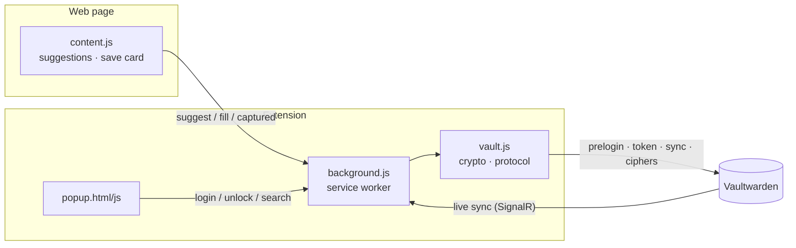

<div align="center">


# Vaultfill for Chrome

**Vaultwarden autofill the way it should be: click the field, pick the login, done.**<br>
No opening the popup, no searching, no "Fill" button.


-8b5cf6)


</div>

---

## ✨ Features

| | |
|---|---|
| ⚡ **Inline suggestions** | Focus a login field → matching entries appear right below it. ↑↓ ⏎; typing filters. |
| ⌨️ **⌘⇧L** | Exactly one match? Filled instantly. Otherwise suggestions – or search in the popup. |
| 💾 **Save & update** | After you sign in, Vaultfill asks "Save?" or "Update password?" (the old password goes to the history). |
| 🎲 **Password generator** | On sign-up pages: a strong password in both the password *and* the confirmation field. |
| 🔢 **2FA codes** | The current TOTP code of the matching entry is ready in the code field. |
| 🔐 **SSO & 2FA login** | Vaultwarden with SSO (e.g. Entra ID), TOTP or e-mail 2FA. |
| 👆 **Touch ID & PIN** | Unlock with your fingerprint (WebAuthn PRF) or a PIN. Auto-lock after 30 min idle or on screen lock. |
| 🔄 **Live sync** | Changes from other clients arrive within seconds via Vaultwarden's notification hub. |
| 📋 **⌘C / ⌘⇧C** | Copy the username or password of the highlighted entry. |

> The user interface is currently in German.

## 📸 Screenshots

<table>
  <tr>
    <td align="center"><br><sub><b>Save login</b> – after submitting</sub></td>
    <td align="center"><br><sub><b>Generator</b> – on sign-up pages</sub></td>
  </tr>
  <tr>
    <td align="center"><br><sub><b>2FA code</b> – right in the code field</sub></td>
    <td align="center">
      
      <br>
      <sub><b>Popup</b> – search everything · <b>Unlock</b> with Touch ID</sub>
    </td>
  </tr>
</table>

## 🚀 Installation

1. Clone the repository.
2. `chrome://extensions` → enable **Developer mode** → **Load unpacked** → select the folder.
3. Vaultfill icon → server URL, e-mail, master password → **Anmelden** (sign in).
4. Optional: `chrome://extensions/shortcuts` → check the shortcut (default ⌘⇧L, Ctrl+Shift+L on Windows/Linux).

> No `npm install`, no bundler: Chrome loads the folder as it is.

## ⌨️ Usage

| Where | Key | Action |
|---|---|---|
| Login field | `↑` `↓` `⏎` `Esc` | Pick a suggestion / fill / close |
| Login field | `⌘C` · `⌘⇧C` | Copy username · password |
| Anywhere | `⌘⇧L` | Fill, show suggestions or open the popup |
| Popup | type, `⏎` | Search all entries, fill the current page |

## 🛡️ Security model

- **End-to-end like Bitwarden:** key derivation (PBKDF2 / Argon2id) and AES-CBC + HMAC run locally; the server never sees plaintext.
- **Storage:** encrypted vault + tokens in `storage.local`; the decrypted key and index (names, usernames, URLs – **no passwords**) only in `storage.session` (memory).
- **Passwords are decrypted only when filling** – and only for entries that match the URL of the requesting frame. That URL is set by Chrome, not by the web page.
- **Web pages** cannot see the suggestions (closed shadow DOM) and cannot trigger sign-in or unlock.
- **Touch ID:** a WebAuthn passkey with the PRF extension; the PRF output encrypts a copy of the user key. **PIN:** valid until the browser restarts, deleted after 5 wrong attempts.
- **URL matching** uses the [Public Suffix List](https://publicsuffix.org) incl. private suffixes (`evil.github.io` gets nothing from `victim.github.io`); https logins never on http pages, a different port is a different site, "starts with" only within the same origin.
- **Real input only:** filling, copying and capturing react only to genuine keyboard/mouse events and user activation – a page cannot drive the list by script or "submit" passwords.
- **Save offers** are bound to their domain and discarded on lock; only an entry with a matching username is ever updated.
- **Server:** plain http only for local servers; weak or suddenly weakened KDF settings are rejected.

### Known limits

- A page on the same domain can tell *whether* the suggestion list appears (number of entries, locked or not) – not its contents.
- Access tokens live in `storage.local` (like in the official Bitwarden extension); the vault itself stays encrypted.
- A malicious server can inject entries through a crafted organization (a known property of the Bitwarden protocol).

## 🧩 Architecture



| File | Role |
|---|---|
| `vault.js` | Bitwarden protocol: KDF, EncString, login, sync, create/edit entries, URI matching, TOTP, password check |
| `background.js` | State, SSO, unlock, save offers, live sync, auto-lock |
| `content.js` | Field detection, dropdown, generator, 2FA, save card |
| `popup.html/js` | Sign in, unlock, search, settings |

## 🧪 Tests

```bash
npm test   # unit: URI matching, Public Suffix List, KDF checks, PIN, TOTP (RFC 6238), password strength
```

End-to-end against a real Vaultwarden – cross-checked with the **official `bw` CLI** (registration, decryption, adding a URI without data loss). Instructions at the top of [`test/vault.test.mjs`](test/vault.test.mjs).

## 🖥️ Desktop app

Spotlight-style quick search for every app, creating logins, password check and agent access via MCP: **[vaultfill-desktop](https://github.com/deeaitsch84/vaultfill-desktop)**.

## 📄 License

[GPL-3.0](LICENSE) – free to use, modify and share; published derivatives must make their source code available too.
Bundled third-party components keep their licenses: [hash-wasm](lib/hash-wasm.LICENSE) (MIT), [Public Suffix List](lib/psl.LICENSE) (MPL-2.0).
Please report security issues privately – see [SECURITY.md](SECURITY.md).

---

<sub>Unofficial client. Bitwarden is a trademark of Bitwarden Inc.; Vaultfill is not affiliated with it.</sub>
