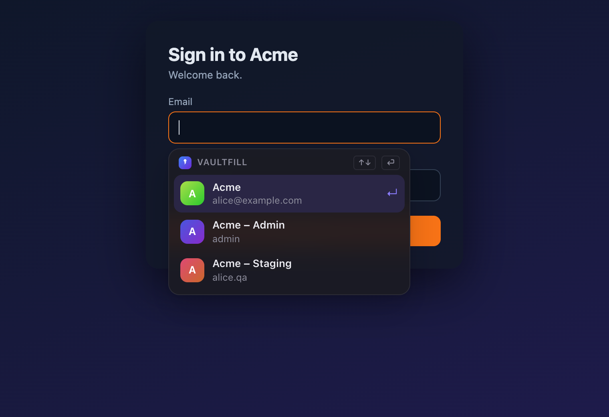
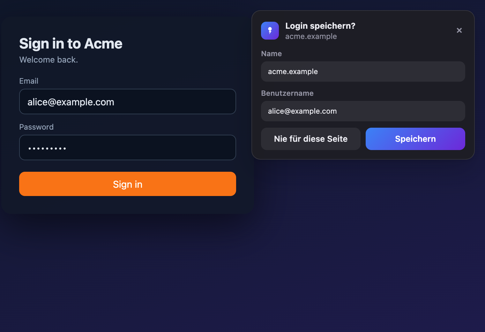
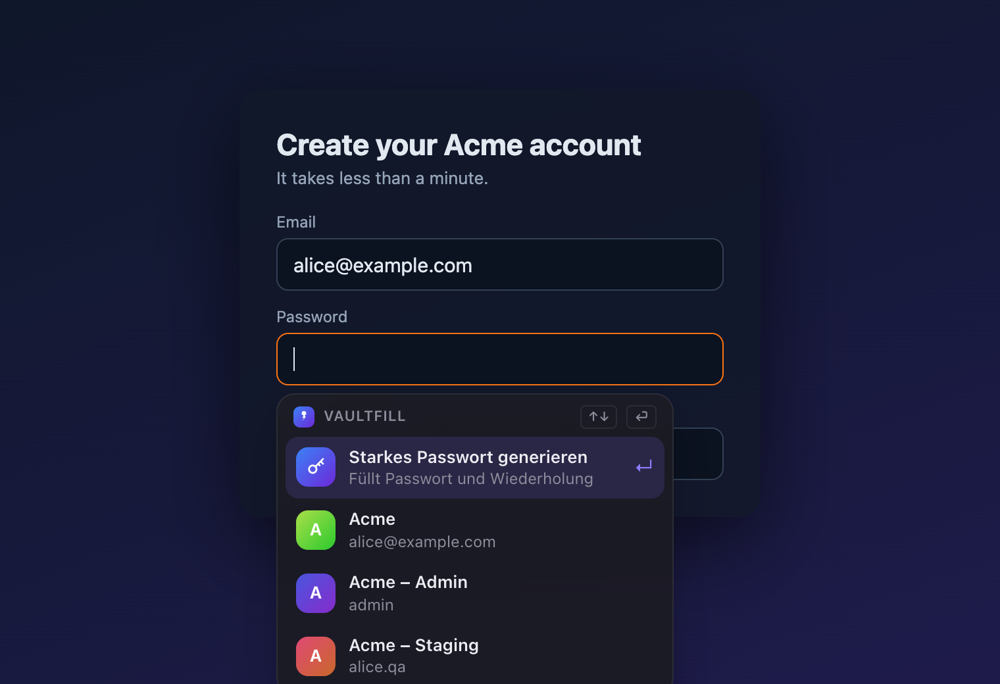
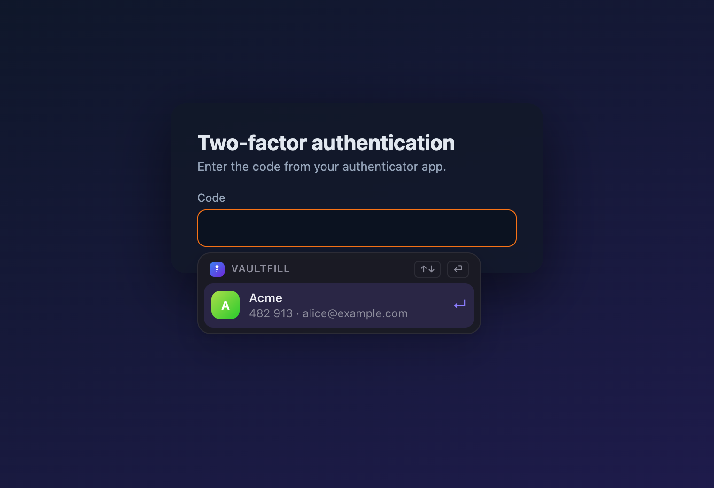
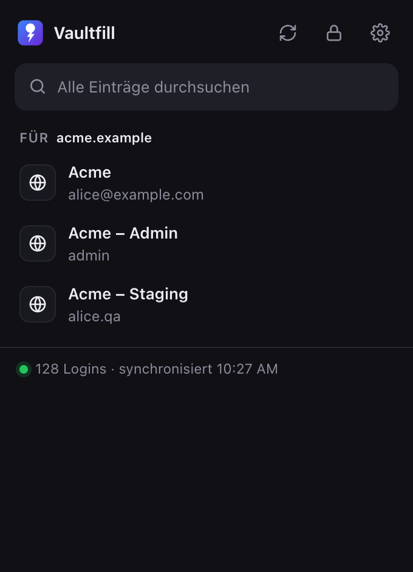
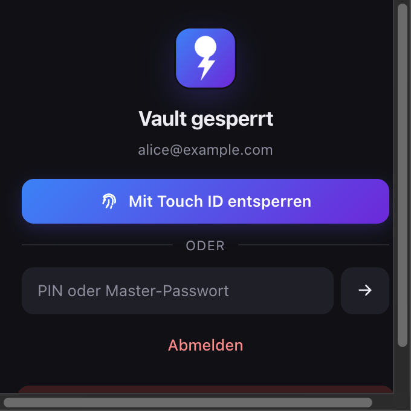
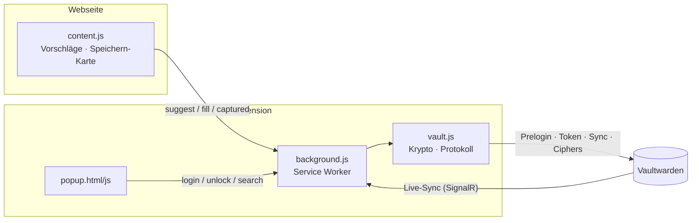

<div align="center">


# Vaultfill für Chrome

**Autofill für Vaultwarden, wie es sein sollte: Feld anklicken, Login wählen, fertig.**<br>
Kein Popup öffnen, kein Suchen, kein „Fill“-Button.


-8b5cf6)



</div>

---

## ✨ Was es kann

| | |
|---|---|
| ⚡ **Inline-Vorschläge** | Login-Feld fokussieren → passende Einträge erscheinen direkt darunter. ↑↓ ⏎, tippen filtert. |
| ⌨️ **⌘⇧L** | Genau ein Treffer? Sofort gefüllt. Sonst Vorschläge – oder die Suche im Popup. |
| 💾 **Speichern & Aktualisieren** | Nach dem Login fragt Vaultfill „Speichern?“ bzw. „Passwort aktualisieren?“ (altes Passwort → Historie). |
| 🎲 **Passwort-Generator** | Auf Registrierungsseiten: starkes Passwort in Passwort *und* Wiederholung. |
| 🔢 **2FA-Codes** | Im Code-Feld steht der aktuelle TOTP-Code des passenden Eintrags bereit. |
| 🔐 **SSO & 2FA-Login** | Vaultwarden mit SSO (z. B. Entra ID), TOTP- oder E-Mail-2FA. |
| 👆 **Touch ID & PIN** | Entsperren per Fingerabdruck (WebAuthn-PRF) oder PIN. Auto-Sperre nach 30 min / Bildschirmsperre. |
| 🔄 **Live-Sync** | Änderungen aus anderen Clients kommen über Vaultwardens Notification-Hub in Sekunden an. |
| 📋 **⌘C / ⌘⇧C** | Benutzername bzw. Passwort des markierten Eintrags kopieren. |

## 📸 Screenshots

<table>
  <tr>
    <td align="center"><br><sub><b>Login speichern</b> – nach dem Absenden</sub></td>
    <td align="center"><br><sub><b>Generator</b> – auf Registrierungsseiten</sub></td>
  </tr>
  <tr>
    <td align="center"><br><sub><b>2FA-Code</b> – direkt im Code-Feld</sub></td>
    <td align="center">
      
      <br>
      <sub><b>Popup</b> – Suche über alles · <b>Entsperren</b> mit Touch ID</sub>
    </td>
  </tr>
</table>

## 🚀 Installation

1. Repository klonen.
2. `chrome://extensions` → **Entwicklermodus** an → **Entpackte Erweiterung laden** → Ordner wählen.
3. Vaultfill-Icon → Server-URL, E-Mail, Master-Passwort → **Anmelden**.
4. Optional: `chrome://extensions/shortcuts` → Kürzel prüfen (Standard ⌘⇧L).

> Kein `npm install`, kein Bundler: Chrome lädt den Ordner so wie er ist.

## ⌨️ Bedienung

| Wo | Taste | Aktion |
|---|---|---|
| Login-Feld | `↑` `↓` `⏎` `Esc` | Vorschlag wählen / füllen / schließen |
| Login-Feld | `⌘C` · `⌘⇧C` | Benutzername · Passwort kopieren |
| überall | `⌘⇧L` | Füllen, Vorschläge oder Popup |
| Popup | tippen, `⏎` | Alle Einträge durchsuchen, aktuelle Seite füllen |

## 🛡️ Sicherheitsmodell

- **Ende-zu-Ende wie Bitwarden:** Schlüsselableitung (PBKDF2 / Argon2id) und AES-CBC + HMAC laufen lokal; der Server sieht nie Klartext.
- **Speicherorte:** verschlüsselter Vault + Tokens in `storage.local`; entschlüsselter Schlüssel und Index (Namen, Benutzernamen, URLs – **keine Passwörter**) nur in `storage.session` (RAM).
- **Passwörter erst beim Füllen** entschlüsselt – und nur für Einträge, die zur URL des anfragenden Frames passen. Die URL setzt Chrome, nicht die Webseite.
- **Webseiten** sehen die Vorschläge nicht (geschlossenes Shadow DOM) und können weder Login noch Entsperren auslösen.
- **Touch ID:** WebAuthn-Passkey mit PRF-Erweiterung; das PRF-Ergebnis verschlüsselt eine Kopie des User-Keys. **PIN:** nur bis zum Browser-Neustart, 5 Fehlversuche → gelöscht.

## 🧩 Aufbau



| Datei | Aufgabe |
|---|---|
| `vault.js` | Bitwarden-Protokoll: KDF, EncString, Login, Sync, Einträge anlegen/ändern, URI-Matching, TOTP, Passwort-Check |
| `background.js` | Zustand, SSO, Entsperren, Speichern-Angebote, Live-Sync, Auto-Sperre |
| `content.js` | Felderkennung, Dropdown, Generator, 2FA, Speichern-Karte |
| `popup.html/js` | Anmelden, Entsperren, Suche, Einstellungen |

## 🧪 Tests

```bash
npm test   # Unit: URI-Matching, PIN, TOTP (RFC 6238), Passwortstärke
```

E2E gegen ein echtes Vaultwarden – gegengeprüft mit der **offiziellen `bw` CLI** (Registrierung, Entschlüsselung, URI ergänzen ohne Datenverlust). Anleitung im Kopf von [`test/vault.test.mjs`](test/vault.test.mjs).

## 🖥️ Desktop-App

Spotlight-artige Schnellsuche für alle Apps, Logins anlegen, Passwort-Check und Agenten-Zugriff per MCP: **[vaultfill-desktop](https://github.com/deeaitsch84/vaultfill-desktop)**.

---

<sub>Inoffizieller Client. Bitwarden ist eine Marke der Bitwarden Inc.; Vaultfill ist damit nicht verbunden.</sub>
